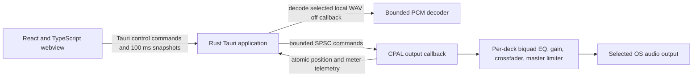

# Milestone 1 architecture

**Status:** PROPOSED implementation architecture 
**Owner:** SAYT project owner 
**Date:** 2026-11-25 
**Version:** 0.1.0

## Boundaries

The UI sends control values and receives snapshots; sample buffers never cross ordinary Tauri IPC. The nonblocking native file picker supplies the local path through an async command. WAV decoding and filter coefficient calculation occur outside the audio callback. The callback renders both decks into one selected output stream.

## Real-time ownership

- The Tauri side owns `EngineSettings`, command production, output-device lifecycle, snapshot serialization, and destruction of retired tracks.
- The callback owns playback cursors and filter state. It consumes from a bounded SPSC command ring (64 entries), processing no more than 16 commands per callback.
- Replaced `Arc<Track>` values go through a bounded callback-to-control return ring (128 entries). If it is full, replacement remains pending rather than freeing a track in the callback.
- Position, playing state, meter, and output-error signals cross the boundary through atomics. Track generations prevent snapshots from applying telemetry from a replaced track.
- Tauri commands use a mutex around the control-side `Engine`; the audio callback never accesses that mutex.
- The callback writes equilibrium to any incomplete trailing output frame.

## Signal path

`WAV PCM -> stereo frames -> per-deck low shelf / mid peaking / high shelf -> deck gain -> equal-power crossfader -> master level -> tanh soft limiter -> device sample format`.

The EQ bands are centered at 200 Hz, 1 kHz, and 5 kHz nominally. Frequencies are clamped for low-rate output devices. The current output supports CPAL `f32`, `i16`, or `u16` device formats and uses the selected device's default output configuration.

## Known ceilings and risks

- Both decoded tracks remain in memory. Each deck is bounded at 32 million stereo frames; two maximum tracks use about 512 MiB of sample payload before overhead.
- Device identifiers are current enumeration indexes, not durable hardware identities; they can change when devices appear or disappear.
- Only one master output bus exists. Headphone cue, multi-output routing, device hot-plug recovery, callback load/xrun telemetry, and a long soak test are not implemented.
- The Tauri UI polls snapshots every 100 ms. This is control telemetry, not a hard real-time synchronization clock.
- A single CPAL stream/device is the current output dependency. Device and platform behavior still needs Windows/macOS/Linux CI and physical hardware verification.

## Decisions

- Rust remains the engine implementation under ADR-001 and `docs/DECISIONS/ADR-003-rust-engine-milestone1.md`; the alternate C++ direction in the master brief is recorded as a conflict and reasoned deviation.
- Tauri 2 and React remain the desktop shell under ADR-002.
- No project license is selected. Third-party dependency licensing is documented separately in `docs/DEPENDENCIES_AND_LICENSES.md`.
